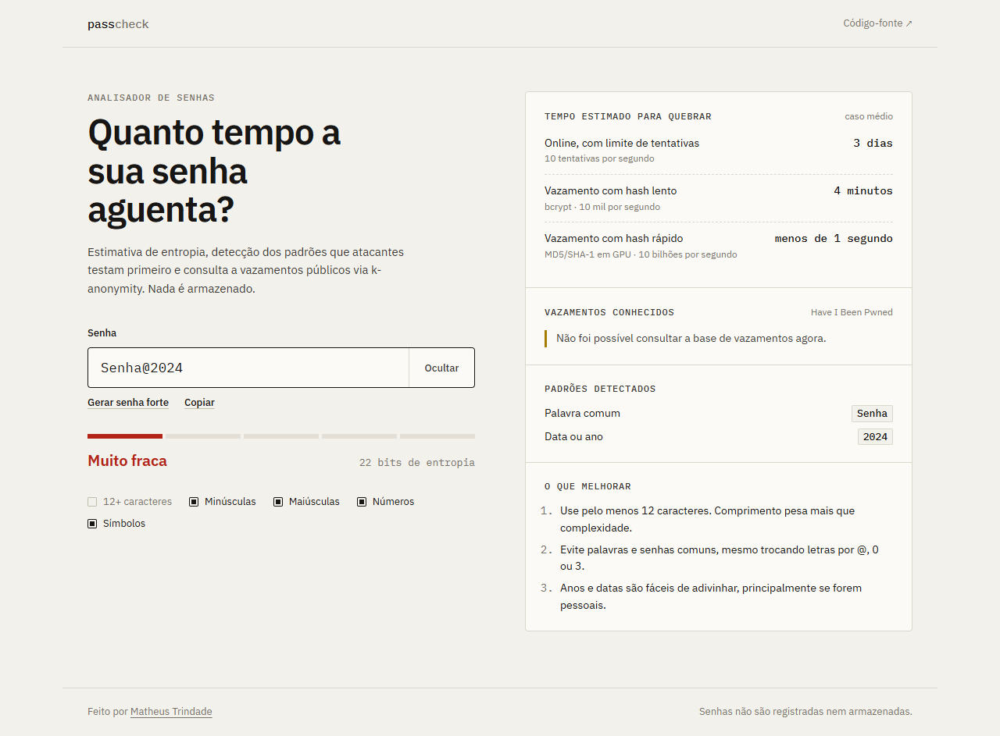
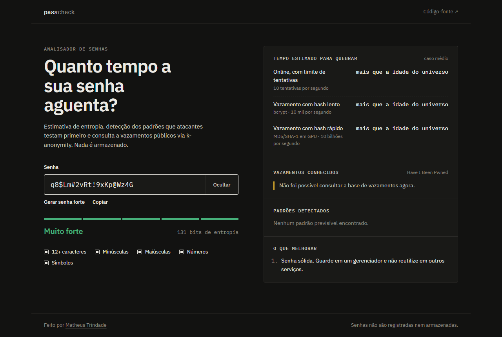

# Password Strength Checker

Analisador de senhas que estima **quanto tempo um atacante levaria para quebrá-las**, com base em entropia efetiva, detecção dos padrões que listas de ataque testam primeiro e consulta a vazamentos públicos via [Have I Been Pwned](https://haveibeenpwned.com/Passwords) com k-anonymity.


<p align="center">
  
  
</p>

## Por que outro verificador de senha?

A maioria dos medidores conta tipos de caractere: `Senha@2024` tem maiúscula, minúscula, número e símbolo, então seria "forte". Na prática, ela cai em segundos, porque é uma palavra comum seguida de um ano, exatamente o que ferramentas como Hashcat e John the Ripper testam primeiro.

Este projeto mede o que importa: **quantas tentativas um ataque realista precisa fazer**.

| Senha | Medidor tradicional | Este projeto |
| --- | --- | --- |
| `Senha@2024` | Forte | Muito fraca · 22 bits · palavra comum + ano |
| `P@ssw0rd!` | Forte | Muito fraca · 17 bits · palavra com substituições |
| `qwerty123` | Média | Muito fraca · 8 bits · senha comum |
| `q8$Lm#2vRt!9xKp@Wz4G` | Forte | Muito forte · 131 bits |

## Funcionalidades

- **Entropia efetiva**: parte da força bruta (`comprimento × log2(alfabeto)`) e desconta os trechos previsíveis.
- **Detecção de padrões**: palavras e senhas comuns (PT-BR e EN), substituições leet (`@→a`, `0→o`, `3→e`...), sequências (`abc`, `4321`), padrões de teclado (`qwerty`, `asdf`), repetições (`aaaa`, `abcabc`), anos e datas.
- **Tempo de quebra em três cenários**: ataque online com rate-limit, vazamento com hash lento (bcrypt) e vazamento com hash rápido em GPU.
- **Vazamentos conhecidos**: consulta ao Pwned Passwords sem nunca enviar a senha nem o hash completo. Se a senha aparece em vazamentos, ela é marcada como comprometida, independente da entropia. Se a consulta falha, a interface diz que não conseguiu verificar e não mostra a senha como segura.
- **Gerador de senhas**: 20 caracteres gerados no navegador com `crypto.getRandomValues`, sem viés de módulo e sem caracteres ambíguos (`l`, `I`, `O`, `0`, `1`).
- **Recomendações acionáveis**: até quatro dicas, priorizadas pelo que mais enfraquece a senha.
- **Interface**: tema claro e escuro automáticos, responsiva, navegável por teclado e com `aria-live` no resultado.

## Como funciona

```
senha ──► alfabeto + comprimento ──► entropia de força bruta
   │
   ├──► detectores de padrão ──► seleção gulosa sem sobreposição ──► entropia efetiva
   │                                                                      │
   │                                                                      ├──► score (0–4)
   │                                                                      └──► tempo de quebra × 3 cenários
   │
   └──► SHA-1 ──► prefixo (5 chars) ──► HIBP /range ──► comparação local do sufixo
```

| Score | Entropia efetiva | Classificação |
| --- | --- | --- |
| 0 | < 28 bits | Muito fraca |
| 1 | 28–35 bits | Fraca |
| 2 | 36–59 bits | Razoável |
| 3 | 60–79 bits | Forte |
| 4 | ≥ 80 bits | Muito forte |

Senhas com menos de 8 caracteres ficam limitadas ao score 1. Senhas encontradas em vazamentos ficam com score 0.

O modelo completo (custos de cada padrão, cenários de ataque e limitações) está em [`docs/explanation.md`](docs/explanation.md).

## Rodando localmente

Requisitos: Python 3.10+.

```bash
git clone https://github.com/MatheussTrindade/Password-Strength-Checker.git
cd Password-Strength-Checker

python -m venv .venv
source .venv/bin/activate        # Windows: .venv\Scripts\activate

pip install -r requirements.txt
python run.py
```

Acesse <http://127.0.0.1:5000>.

### Configuração

| Variável | Padrão | Descrição |
| --- | --- | --- |
| `HOST` | `127.0.0.1` | Interface onde o servidor escuta. |
| `PORT` | `5000` | Porta HTTP. |
| `FLASK_DEBUG` | desligado | `1` ativa o modo debug. Não use em produção. |
| `REQUESTS_CA_BUNDLE` | — | Caminho para o certificado da CA do proxy corporativo. É a forma recomendada de resolver erros de TLS em rede corporativa. |
| `HIBP_INSECURE_SSL` | desligado | `1` desativa a verificação TLS na chamada ao HIBP. Use só como último recurso em ambiente de desenvolvimento. |

## API

### `POST /check`

```http
POST /check
Content-Type: application/json

{ "password": "Senha@2024" }
```

```json
{
  "score": 0,
  "label": "Muito fraca",
  "entropy": 22.4,
  "length": 10,
  "patterns": [
    { "type": "dictionary", "label": "Palavra comum", "token": "Senha" },
    { "type": "date", "label": "Data ou ano", "token": "2024" }
  ],
  "crack_times": [
    { "id": "online", "seconds": 276450.0, "display": "3 dias" },
    { "id": "offline_slow", "seconds": 276.45, "display": "4 minutos" },
    { "id": "offline_fast", "seconds": 0.00028, "display": "menos de 1 segundo" }
  ],
  "pwned": { "checked": true, "count": 0 },
  "feedback": [
    "Use pelo menos 12 caracteres. Comprimento pesa mais que complexidade.",
    "Evite palavras e senhas comuns, mesmo trocando letras por @, 0 ou 3.",
    "Anos e datas são fáceis de adivinhar, principalmente se forem pessoais."
  ]
}
```

| Status | Quando |
| --- | --- |
| `200` | Análise concluída. A resposta é enviada com `Cache-Control: no-store`. |
| `400` | Corpo inválido, campo `password` ausente, vazio, não textual ou com mais de 256 caracteres. |

## Testes

```bash
pip install -r requirements-dev.txt
pytest
```

A suíte cobre os detectores de padrão, o score, a formatação de tempo, a validação da rota e o cliente HIBP. O HIBP é simulado nos testes, que rodam sem rede. Os testes do cliente conferem que só o prefixo do hash é enviado.

## Estrutura

```
.
├── app/
│   ├── __init__.py          # app factory + headers de segurança (CSP, nosniff, referrer)
│   ├── routes.py            # GET /  e  POST /check
│   ├── checker.py           # entropia, detectores de padrão, score e recomendações
│   ├── data/common.txt      # lista de senhas e palavras comuns (PT-BR/EN)
│   └── services/pwned.py    # cliente Pwned Passwords (k-anonymity, cache por prefixo)
├── static/                  # CSS, JS e favicon
├── templates/index.html
├── tests/                   # pytest
├── docs/
│   ├── explanation.md       # modelo técnico detalhado
│   └── screenshots/
└── run.py
```

## Segurança e privacidade

- A senha é analisada em memória e descartada. Ela não é registrada em log nem salva.
- Para o HIBP só vai o prefixo de 5 caracteres do SHA-1, com o header `Add-Padding` para dificultar análise de tráfego.
- As respostas usam `Content-Security-Policy` restritiva, `X-Content-Type-Options: nosniff` e `Referrer-Policy: no-referrer`.
- O front-end monta o DOM só com `textContent`, então o conteúdo digitado nunca vira HTML.
- **A senha trafega do navegador para o servidor.** Em qualquer deploy fora de `localhost`, use HTTPS.

## Limitações

- A lista de palavras é intencionalmente curta (cerca de 200 entradas). Palavras fora dela não são detectadas: `Tr0ub4dor&3`, por exemplo, é superestimada.
- O modelo não conhece informações pessoais do usuário (nome, data de nascimento, nome do pet), que costumam ser as primeiras tentativas em ataques direcionados.
- As estimativas de tempo são ordens de grandeza para comparação, não garantias.

## Roadmap

- [ ] Wordlist maior, carregada sob demanda (ex.: top 100k do RockYou).
- [ ] Gerador de frases-senha (diceware) com opções de tamanho.
- [ ] Modo 100% client-side, em que a senha nunca sai do navegador.
- [ ] Dockerfile e deploy com Gunicorn.

## Autor

Feito por **Matheus Trindade** · [GitHub](https://github.com/MatheussTrindade)
